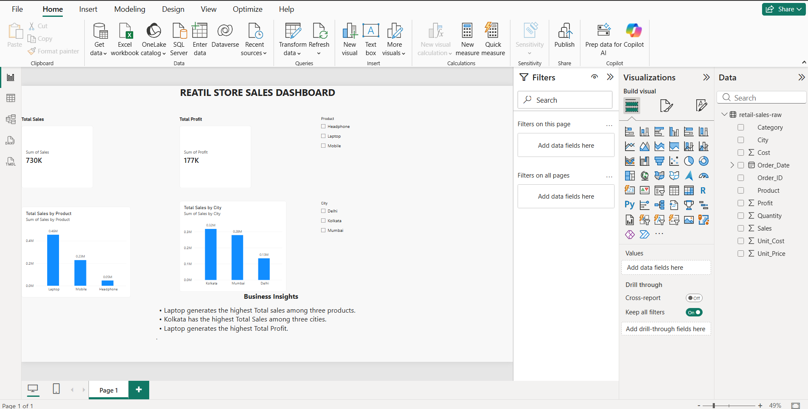

# Retail Sales Analysis 📊

## 📌 Project Overview
This project analyzes retail sales data to understand business performance, product profitability, and city-wise sales performance.

The goal is to turn raw sales data into useful business insights using data analysis tools.

## 🎯 Project Objectives
- Calculate total sales and total profit.
- Identify the best-performing city.
- Compare sales and profit across products.
- Calculate average sales, maximum sales, and profit margin.
- Create a dashboard to communicate findings.
- Provide practical business recommendations.

## 🛠️ Tools & Technologies
- **Microsoft Excel** — Data organization and summary calculations
- **Python (Pandas)** — Data cleaning, grouping, and statistical analysis
- **Power BI** — Dashboard and visualizations
- **MySQL** — SQL queries and business analysis

## 📈 Key Performance Indicators (KPIs)
- **Total Sales:** ₹730,000
- **Total Profit:** ₹177,000
- **Average Sales:** ₹36,505
- **Maximum Sales:** ₹108,000
- **Profit Margin:** 24.3%

*Note: Verify these figures against the final dataset and project files before publishing.*

## 🔍 Data Analysis Process
1. Imported the retail sales dataset.
2. Checked the data for missing values and duplicate records.
3. Calculated sales, costs, and profit metrics.
4. Analyzed performance by city and product.
5. Created charts and summary statistics using Python.
6. Built a Power BI dashboard to present the results.

## 💡 Key Findings
- Kolkata recorded the highest total sales among the cities analyzed.
- Laptop was the leading product in sales and profit in this analysis.
- The average sales value was ₹36,505.
- The maximum recorded sale was ₹108,000.
- The calculated overall profit margin was approximately 24.3%.

## ✅ Business Recommendations
- Monitor laptop inventory and plan stock replenishment carefully.
- Investigate the factors contributing to Kolkata's sales performance.
- Track profit margins alongside revenue when making pricing decisions.
- Review sales and profit trends regularly using the dashboard.

## 📁 Project Structure
```text
Retail-Sales-Analysis/
├── data/
│   └── retail_sales_data.xlsx
├── excel/
│   └── retail_sales_analysis.xlsx
├── python/
│   └── retail_sales_analysis.ipynb
├── powerbi/
│   └── retail_sales_dashboard.pbix
├── sql/
│   └── retail_sales_queries.sql
└── README.md
```

*The file names above are examples. Replace them with your actual files.*

## 🚀 Project Status
Excel, Python, and Power BI analysis have been started. SQL queries and final portfolio documentation can be added as the project progresses.

## 👩‍💻 Author
**Monali Paul**

Aspiring Data Analyst | Excel | Python | Power BI | MySQL
## 📊 Power BI Dashboard


